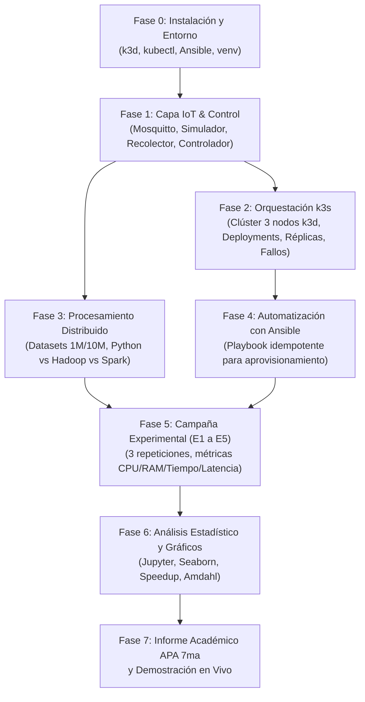

# Plan de Trabajo y Guía de Implementación: Sistema Automatizado de Cultivo Hidropónico Distribuido

> **Materia:** Sistemas Operativos Distribuidos (SOD) — 4to Año, 2do Cuatrimestre  
> **Proyecto:** Trabajo Integrador Final (TIF) — AE 4  
> **Estado:** Propuesta de Planificación e Inicio  
> **Versión:** 1.0.0  

---

## 1. Resumen Ejecutivo del Proyecto

El objetivo es desarrollar un entorno distribuido integral que modele un sistema de cultivo hidropónico automatizado mediante:
1. **Internet de las Cosas (IoT) y Mensajería:** Sensores distribuidos publicando métricas (pH, conductividad eléctrica, temperatura, humedad, nivel de agua) hacia un broker MQTT (**Eclipse Mosquitto**), recolectados por un servicio de ingesta y supervisados por un **controlador en lazo cerrado** en tiempo real.
2. **Virtualización y Orquestación:** Empaquetado en **Docker** / **Docker Compose** y orquestación con **k3s** (a través de **k3d**) para simular un clúster multinodo de Kubernetes con escalabilidad horizontal y tolerancia a fallos.
3. **Procesamiento Distribuido (Big Data):** Comparación de rendimiento y escalabilidad entre **Python Secuencial**, **Apache Hadoop (MapReduce)** y **Apache Spark (Batch y Structured Streaming)** sobre grandes volúmenes sintéticos (1M, 10M y 100M de registros).
4. **Infraestructura como Código (IaC):** Playbook de **Ansible** idempotente para la instalación y aprovisionamiento del entorno.
5. **Campaña de Mediciones (E1 a E5):** Recolección metódica de métricas de rendimiento, speedup, uso de CPU/RAM y latencias, analizadas estadísticamente en **Jupyter Notebooks** y documentadas en un **Informe Académico en formato APA (7.ª edición)** para la defensa oral con demostración en vivo.

---

## 2. Diagnóstico del Entorno Actual (Host: CachyOS / Arch Linux)

| Componente | Estado Actual | Acción Requerida |
| :--- | :--- | :--- |
| **Sistema Operativo** | CachyOS Linux (Kernel optimizado, base Arch) | Compatible al 100% |
| **Docker Engine** | Instalado (`/usr/local/bin/docker`) y activo | Listo para usar |
| **Docker Compose** | Instalado (Plugin v5.5.1) | Listo (`docker compose ...`) |
| **Python 3** | Instalado (`/usr/bin/python3`) | Crear entorno virtual local (`venv`) |
| **Git** | Instalado (`/usr/bin/git`) | Listo para control de versiones |
| **k3d** | No encontrado | Instalar vía AUR (`yay -S k3d-bin`) o script oficial |
| **kubectl** | No encontrado | Instalar vía Pacman (`sudo pacman -S kubectl`) |
| **Ansible** | No encontrado | Instalar vía Pacman (`sudo pacman -S ansible`) o en `venv` |

---

## 3. Prerrequisitos e Instalaciones Necesarias

Para comenzar el desarrollo, se requerirá ejecutar los siguientes comandos en la terminal del sistema:

### 3.1. Instalación de Herramientas del Sistema (CLI)
```bash
# 1. Instalar kubectl y ansible mediante pacman
sudo pacman -S kubectl ansible

# 2. Instalar k3d (gestor de clústeres k3s en Docker)
# Opción A: Vía yay / paru (AUR)
yay -S k3d-bin
# Opción B (alternativa directa sin AUR):
# curl -s https://raw.githubusercontent.com/k3d-io/k3d/main/install.sh | bash
```

### 3.2. Configuración del Entorno Virtual de Python
```bash
# Crear entorno virtual en el directorio del proyecto
python3 -m venv venv

# Activar entorno virtual
source venv/bin/activate

# Instalar librerías esenciales
pip install --upgrade pip
pip install paho-mqtt numpy pandas pyspark matplotlib seaborn jupyter
```

---

## 4. Estructura de Directorios Propuesta para el Proyecto

Para mantener el proyecto modular, ordenado y reproducible, se organizará la raíz del espacio de trabajo de la siguiente forma:

```text
AE 4/
├── AE4_TIF_SOD_2026_D_Hidroponia_ADAPTADA.docx   # Consigna original
├── AE4_TIF_SOD_2026_D_Hidroponia_ADAPTADA.md     # Consigna en Markdown
├── PLAN_DE_TRABAJO.md                            # Este plan maestro de desarrollo
├── Makefile                                      # Automatización de tareas cotidianas (make up, make bench, etc.)
│
├── config/                                       # Configuraciones globales
│   └── mosquitto/
│       └── mosquitto.conf                        # Configuración del broker MQTT
│
├── docker-compose.yml                            # Orquestación local básica (Mosquitto, Recolector, Controlador, Spark, Hadoop)
│
├── ansible/                                      # Automatización e idempotencia
│   ├── inventory.ini
│   ├── playbook.yml                              # Configura herramientas y valida estado
│   └── README.md
│
├── k8s/                                          # Manifiestos de Kubernetes (k3s / k3d)
│   ├── k3d-cluster-config.yaml                   # Definición de 1 server + 2 agents
│   ├── sensor-deployment.yaml                    # Deployment de sensores con réplicas
│   ├── sensor-service.yaml                       # Service y ConfigMaps asociados
│   └── hpa-sensor.yaml                           # Autoscaling opcional
│
├── src/                                          # Código fuente modular
│   ├── common/
│   │   ├── __init__.py
│   │   └── config.py                             # Umbrales hidropónicos, tópicos MQTT, semillas
│   ├── sensors/
│   │   ├── Dockerfile
│   │   ├── requirements.txt
│   │   └── sensor_simulator.py                   # Genera pH, CE, Temp, Humedad, Nivel H2O con ruido y deriva
│   ├── collector/
│   │   ├── Dockerfile
│   │   ├── requirements.txt
│   │   └── collector.py                          # Ingesta MQTT -> almacenamiento persistente (JSON Lines / Parquet)
│   ├── controller/
│   │   ├── Dockerfile
│   │   ├── requirements.txt
│   │   └── controller.py                         # Lazo cerrado: detecta desvíos y envía comandos a actuadores
│   └── processing/                               # Motores de procesamiento para comparación
│       ├── baseline_python/
│       │   └── process_baseline.py               # Procesamiento secuencial puro
│       ├── spark/
│       │   ├── batch_analysis.py                 # Job batch (promedios, ventanas, anomalías)
│       │   └── streaming_processor.py            # Structured Streaming en tiempo real
│       └── hadoop/
│           ├── mapper.py                         # Mapper de Hadoop Streaming
│           ├── reducer.py                        # Reducer de Hadoop Streaming
│           └── run_hadoop_job.sh                 # Script lanzador del contenedor Hadoop
│
├── benchmarks/                                   # Campaña de experimentación (E1 a E5)
│   ├── generate_synthetic_data.py                # Generador de 1M, 10M y 100M de registros con semilla
│   ├── run_experiment_1.py                       # Comparación de volúmenes (Python vs Hadoop vs Spark)
│   ├── run_experiment_2.py                       # Escalabilidad Spark (1, 2, 3 workers)
│   ├── run_experiment_3.py                       # Escalado k3s (1, 5, 20 réplicas)
│   ├── run_experiment_4.py                       # Tolerancia a fallos (Kill Pod / Kill Worker)
│   ├── run_experiment_5.py                       # Latencia del controlador en lazo cerrado
│   └── metrics/                                  # Salida de mediciones en formato CSV
│
├── analysis/                                     # Ciencia de datos y visualización
│   ├── exploratory_analysis.ipynb                # Notebook Jupyter con pruebas y gráficos
│   └── figures/                                  # Gráficos generados para el informe
│
└── docs/                                         # Entregables académicos
    ├── informe_apa.md                            # Borrador y versión final del informe en formato APA 7
    └── presentacion_defensa.md                   # Guion y diapositivas de la defensa oral
```

---

## 5. Fases de Desarrollo Paso a Paso



---

### Fase 0: Aprovisionamiento y Puesta a Punto del Entorno
- [ ] Instalar `kubectl`, `ansible` y `k3d`.
- [ ] Crear el entorno virtual Python `venv` e instalar librerías analíticas.
- [ ] Validar conectividad de Docker y crear la estructura de carpetas inicial.

### Fase 1: Simulación IoT y Control en Lazo Cerrado (Docker Compose)
- [ ] **Configuración MQTT:** Desplegar contenedor `eclipse-mosquitto` con configuración de puerto 1883.
- [ ] **Simulador de Sensores:**
  - Variables modeladas: pH (5.5 - 6.5), CE (1.2 - 2.5 mS/cm), Temperatura (18 - 24 °C), Humedad (60 - 80 %), Nivel de Agua (0 - 100 %).
  - Implementación con semilla determinista, ruido aleatorio gaussiano y deriva temporal.
  - Publicación periódica (1Hz) sobre tópicos: `hidroponia/zona_{id}/sensores/{tipo}`.
- [ ] **Recolector:**
  - Suscripción a `hidroponia/+/sensores/+`.
  - Persistencia bufferizada hacia volumen compartido (`./data/raw/`).
- [ ] **Controlador en Lazo Cerrado:**
  - Suscripción y evaluación en tiempo real de reglas de umbral:
    - *Regla 1:* Si pH > 6.5 -> publica orden en `hidroponia/actuadores/dosificar_acido`.
    - *Regla 2:* Si nivel de agua < 30% -> publica orden en `hidroponia/actuadores/reponer_agua`.
  - Cálculo de timestamp de emisión y recepción para registrar latencia fin-a-fin.
- [ ] **Validación Compose:** Levantar todo el stack con `docker compose up -d` y validar flujo de mensajes.

### Fase 2: Orquestación con k3s (k3d) y Tolerancia a Fallos
- [ ] **Clúster k3d:** Script o configuración para levantar 1 nodo servidor (control-plane) y 2 nodos agentes (workers).
- [ ] **Contenerización e Importación:** Construir imagen local del simulador e importarla al clúster (`k3d image import`).
- [ ] **Manifiestos Kubernetes:**
  - `sensor-deployment.yaml`: Control de réplicas, límites de CPU/Memoria, liveness/readiness probes.
  - `sensor-service.yaml` y ConfigMap para inyectar IP del broker MQTT.
- [ ] **Experimentos de Orquestación:**
  - Probar escalado a 1, 5 y 20 réplicas con `kubectl scale`.
  - Matar pods deliberadamente (`kubectl delete pod ...`) para documentar el autorreinicio (self-healing).

### Fase 3: Procesamiento Distribuido (Python vs Hadoop vs Spark)
- [ ] **Generador de Datos Sintéticos:**
  - Script determinista con semilla fija que genera datasets tabulares en volúmenes de 1M y 10M de registros (y 100M opcional).
  - Campos: `timestamp`, `zona_id`, `sensor_id`, `variable`, `valor`, `alerta`.
- [ ] **Despliegue de Spark Standalone:**
  - Contenedores Docker para 1 Spark Master y 1 a 3 Spark Workers.
  - Scripts PySpark para agregación de medias por zona/ventana y conteo de alertas.
  - PySpark Structured Streaming leyendo del directorio del recolector.
- [ ] **Despliegue de Hadoop (Pseudo-distribuido):**
  - Contenedor con Hadoop Streaming.
  - `mapper.py` (emisión de clave-valor zona y métrica) y `reducer.py` (cálculo de agregación) para ejecutar el mismo cálculo exacto que en Spark.
- [ ] **Baseline en Python:**
  - Script monohilo en Python puro para establecer la línea base de comparación de tiempo y memoria.

### Fase 4: Automatización con Ansible
- [ ] Crear inventario local `ansible/inventory.ini`.
- [ ] Desarrollar `ansible/playbook.yml` con tareas declarativas:
  - Verificación de paquetes y dependencias.
  - Verificación del estado del demonio Docker.
  - Clonado/sincronización de repositorios y directorios.
- [ ] **Prueba de Idempotencia:** Demostrar que la primera corrida aplica cambios y la segunda corrida retorna `changed=0`.

### Fase 5: Campaña Experimental (E1 a E5)
Cada experimento se ejecutará al menos 3 veces calculando media ($\mu$) y desviación estándar ($\sigma$):
- **E1. Volumen de Datos:** Tiempos de ejecución y uso de CPU/RAM para 1M, 10M (y 100M) en Python, Hadoop y Spark.
- **E2. Escalabilidad de Spark:** Evaluación de 1, 2 y 3 workers con dataset de 10M. Cálculo de factor de aceleración (*Speedup* $S_p = T_1 / T_p$).
- **E3. Escalado en k3s:** Caudal de eventos procesados (lecturas/seg) y tiempo de inicialización de pods con 1, 5 y 20 réplicas.
- **E4. Tolerancia a Fallos:**
  - Simular caída de pod en k3s: registrar tiempo de recuperación (TTR).
  - Simular caída de worker de Spark durante un job: evaluar reintento y consistencia.
- **E5. Control Automático:** Medir latencia entre anomalía inyectada y comando al actuador con distinta cantidad de sensores (1, 10, 50).

### Fase 6: Análisis Estadístico y Generación de Gráficos
- [ ] Construir un notebook en Jupyter que cargue los CSV de métricas.
- [ ] Generar gráficos de alta calidad (DPI 300) con Matplotlib/Seaborn:
  - Comparativa de tiempos de respuesta por volumen y tecnología.
  - Curva de Speedup real vs. ideal (Ley de Amdahl).
  - Diagramas de caja (boxplots) de latencias de control en lazo cerrado.
  - Perfiles de consumo de memoria y CPU.

### Fase 7: Redacción del Informe Académico (APA 7) y Preparación de la Defensa
- [ ] **Marco Teórico:**
  - Sistemas operativos distribuidos: definiciones, evolución, conceptos de transparencia, comunicación y sincronización.
  - Virtualización completa vs. contenedores: contraste arquitectónico entre Proxmox VE (KVM + LXC) y Docker.
  - Orquestación con Kubernetes y optimizaciones de k3s / k3d.
  - Paradigmas de procesamiento: MapReduce (Hadoop HDFS) vs. RDDs / memoria distribuida (Apache Spark).
  - Protocolo MQTT y comunicación indirecta desacoplada.
  - Fundamentos agronómicos del cultivo hidropónico (rangos de pH, CE, etc.).
- [ ] **Sección Práctica y Metodología:** Explicación de la arquitectura, diagrama de componentes y despliegue.
- [ ] **Resultados y Discusión:** Análisis cuantitativo de los experimentos E1-E5 apoyado en las tablas y gráficos APA.
- [ ] **Conclusiones y Trabajo Futuro:** Reflexión sobre limitaciones, escalabilidad, y propuestas futuras (Kafka, Ceph, Prometheus/Grafana).
- [ ] **Guion de Demostración en Vivo:**
  1. `docker compose up -d` y verificación de servicios IoT.
  2. Inyección de valor fuera de rango y visualización de la respuesta del controlador.
  3. Ejecución del job en Spark.
  4. Escalado en k3s (`kubectl scale`) y eliminación deliberada de un pod para mostrar autorrecuperación.

---

## 6. Checklist de Validación y Criterios de Aprobación

- [ ] Todas las herramientas necesarias instaladas y operativas en el host.
- [ ] Simulación MQTT funcional con intercambio de mensajes verificado.
- [ ] Controlador reaccionando a desvíos en tiempo real con registro de latencias.
- [ ] Clúster k3d de 3 nodos desplegado y pods de sensores orquestados.
- [ ] Mismo cálculo analítico ejecutado con éxito en Python, Hadoop y Spark.
- [ ] Playbook de Ansible ejecutado dos veces demostrando idempotencia (`changed=0`).
- [ ] Experimentos E1 a E5 ejecutados con 3 repeticiones y métricas consolidadas en CSV.
- [ ] Gráficos comparativos y notebook de análisis completos.
- [ ] Documento del informe final redactado bajo norma APA 7.ª edición con citas rigurosas.
- [ ] Repositorio con `README.md` exhaustivo y script de demostración rápida para el tribunal evaluador.

---
*Archivo generado para revisión inicial antes de comenzar la codificación.*

