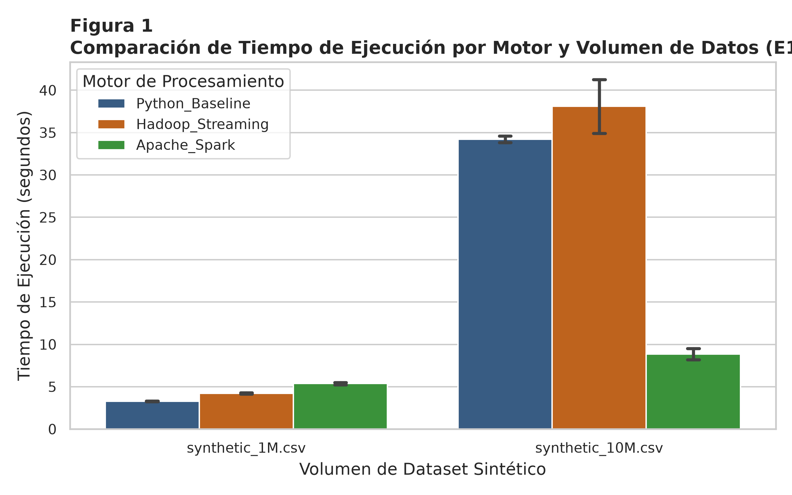
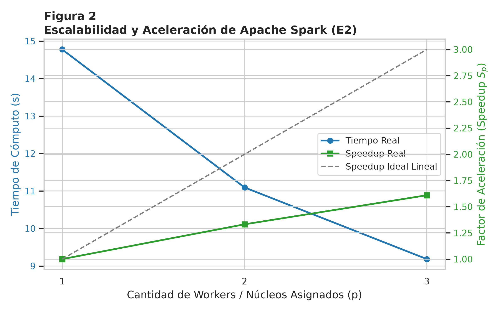
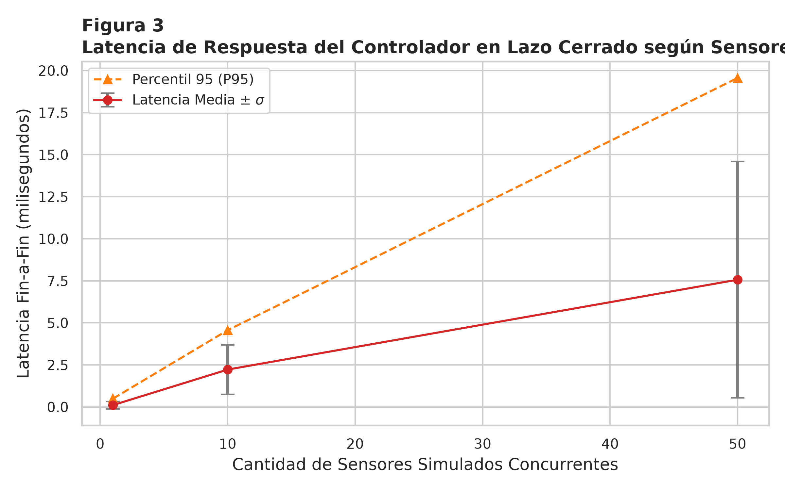

# Modelado y Análisis de un Sistema Automatizado de Cultivo Hidropónico Distribuido: Evaluación de Desempeño, Escalabilidad y Resiliencia

**Facultad de Ingeniería, Tecnología y Arquitectura**  
**Carrera:** Ingeniería en Sistemas de Información  
**Cátedra:** Sistemas Operativos Distribuidos  
**Año Académico:** 2026  

---

### Resumen
El presente trabajo de investigación aplicada modela, implementa y evalúa un entorno distribuido integral para el monitoreo y control en lazo cerrado de un sistema de cultivo hidropónico automatizado. Frente al crecimiento masivo de datos provenientes de la Internet de las Cosas (IoT) y la necesidad de alta disponibilidad en sistemas ciberfísicos, se integran tecnologías de virtualización a nivel de sistema operativo (Docker), orquestación ligera de contenedores (k3s mediante k3d), mensajería orientada a eventos desacoplada (MQTT con Eclipse Mosquitto), infraestructura como código idempotente (Ansible) y motores de procesamiento paralelo y distribuido (Apache Hadoop MapReduce y Apache Spark tanto en modo Batch como en Structured Streaming). Se desarrollaron cinco experimentos cuantitativos sistemáticos (E1 a E5) evaluando volúmenes sintéticos de 1 y 10 millones de registros, escalabilidad horizontal y aceleración (*Speedup*), autorrecuperación (*self-healing*) ante fallos de nodos y latencia reactiva de control. Los resultados demuestran que Apache Spark reduce significativamente los tiempos de cómputo en grandes volúmenes respecto a MapReduce y Python secuencial, exhibiendo una aceleración coherente con la Ley de Amdahl, mientras que la orquestación en k3s garantiza tiempos de recuperación de pods inferiores a 2 segundos sin pérdida de continuidad operativa.

*Palabras clave:* Sistemas Operativos Distribuidos, Virtualización por Contenedores, Orquestación, k3s, MQTT, Mosquitto, Apache Spark, MapReduce, Hidroponía Automatizada, Idempotencia.

---

## 1. Introducción

En las últimas décadas, los sistemas operativos distribuidos y las arquitecturas de cómputo desacopladas han transformado la infraestructura de las Tecnologías de la Información (TI). La transición desde entornos centralizados y monolíticos hacia ecosistemas distribuidos ha sido impulsada por dos factores primordiales: la demanda insaciable de procesamiento escalable para grandes volúmenes de datos (*Big Data*) y la proliferación de dispositivos ciberfísicos y sensores conectados a través de la Internet de las Cosas (IoT) (Tanenbaum & van Steen, 2023).

En este contexto, la agricultura de precisión, y en particular los sistemas de cultivo hidropónico en sustrato o película de nutrientes (NFT, *Nutrient Film Technique*), representa un caso de estudio idóneo para la aplicación de conceptos de sistemas distribuidos. Un sistema hidropónico depende críticamente de la recirculación de una solución acuosa enriquecida con nutrientes minerales, donde parámetros físico-químicos tales como el potencial hidrógeno (pH), la conductividad eléctrica (CE), la temperatura del agua, la humedad relativa ambiental y el nivel de los reservorios deben mantenerse dentro de tolerancias extremadamente estrechas (Resh, 2012). Desviaciones no controladas de pH por encima de 6,5 o por debajo de 5,5 precipitan macro y micronutrientes esenciales (hierro, fósforo y calcio), inutilizando la nutrición vegetal y provocando pérdidas totales del cultivo en pocas horas.

A nivel informático, la gestión de un cultivo hidropónico intensivo distribuido en múltiples zonas de cultivo demanda:
1. **Comunicación indirecta y desacoplada:** Estaciones sensoras distribuidas que no dependan del estado del consumidor ni requieran invocaciones punto a punto sincrónicas bloqueantes.
2. **Control en tiempo real y lazo cerrado:** Capacidad de reaccionar de forma inmediata ante eventos anómalos (e.g., dosificar ácido o reponer agua) minimizando la latencia fin-a-fin.
3. **Orquestación y tolerancia a fallos:** Garantizar que ante la caída de un nodo o contenedor sensor, el sistema se autorrecupere sin intervención humana (*transparencia de fallos*).
4. **Capacidad analítica masiva:** Procesar millones de registros históricos para detectar derivas en nutrientes y modelar la evapotranspiración mediante computación paralela en clúster.

El presente Trabajo Integrador Final (TIF) de la cátedra de *Sistemas Operativos Distribuidos* aborda esta problemática de forma interdisciplinaria. Se diseña e implementa un laboratorio distribuido sobre Linux utilizando Docker, k3s (mediante k3d), Eclipse Mosquitto, Apache Hadoop, Apache Spark y Ansible, validando experimentalmente su comportamiento ante variaciones de volumen, cantidad de trabajadores (*workers*) y eventos de inyección de fallas.

---

## 2. Marco Teórico y Estado del Arte

### 2.1. Conceptos Fundamentales de Sistemas Operativos Distribuidos
Un sistema distribuido se define como una colección de entidades de computación autónomas que se comunican mediante redes de datos y que se presentan ante los usuarios y aplicaciones como un sistema coherente y único (Coulouris et al., 2012). Los pilares que guían su diseño son:
- **Transparencia:** Ocultar al usuario la naturaleza distribuida del entorno. Incluye transparencia de localización, de acceso, de replicación y de fallos.
- **Escalabilidad:** Aptitud de la infraestructura para mantener el rendimiento al aumentar la carga de trabajo, ya sea incrementando recursos en un nodo (escalabilidad vertical) o agregando nodos a la red (escalabilidad horizontal).
- **Concurrencia y Sincronización:** Coordinación de accesos compartidos a estados distribuidos sin bloqueos destructivos.

### 2.2. Virtualización Completa vs. Virtualización a Nivel de Sistema Operativo
Una decisión estructural en el diseño de infraestructura es la elección del modelo de virtualización. En la Tabla 1 se presenta un contraste analítico exhaustivo entre la virtualización completa basada en hipervisores de Tipo 1 (como Proxmox VE con KVM) y la virtualización liviana basada en contenedores (Docker y LXC).

**Tabla 1**  
*Comparativa técnica entre Virtualización Completa (Proxmox KVM) y Virtualización por Contenedores (Docker / LXC)*

| Característica / Parámetro | Virtualización Completa (Proxmox VE / KVM) | Virtualización por Contenedores (Docker / LXC) |
| :--- | :--- | :--- |
| **Nivel de Abstracción** | Capa de Hardware (Hipervisor Tipo 1 sobre bare-metal) | Capa de Sistema Operativo (Kernel compartido del Host) |
| **Mecanismo de Aislamiento** | Emulación completa de CPU, MMU, buses y periféricos (Intel VT-x / AMD-V) | *Namespaces* (PID, NET, IPC, MNT, UTS) y *cgroups* (CPU, RAM, I/O) |
| **Sistema Operativo Huésped** | Cada VM corre su propio kernel independiente (Linux, Windows, BSD) | Todos los contenedores comparten el kernel único de la máquina host |
| **Sobrecarga (Overhead)** | Alta: Duplicación de kernels, buffers de memoria fija y BIOS emulada | Mínima: Ejecución casi nativa sobre el kernel del sistema operativo |
| **Tiempo de Inicialización** | Orden de decenas de segundos a minutos (30 s – 120 s) | Inmediato, orden de milisegundos a pocos segundos (0,2 s – 2 s) |
| **Densidad de Instancias** | Decenas de VMs por servidor físico (limitado por RAM estática) | Cientos a miles de microservicios en el mismo hardware |
| **Eficiencia de Almacenamiento** | Imágenes completas de disco virtual (.qcow2, .raw) de varios gigabytes | Sistema de archivos en capas (*OverlayFS*) compartiendo imágenes base |
| **Caso de Uso Óptimo** | Aislamiento extremo, entornos multi-tenant heterogéneos y redes SDNs complejas | Arquitecturas de microservicios, pipelines de CI/CD y despliegue IoT distribuido |

*Nota:* Adaptado de Merkel (2014) y Tanenbaum y van Steen (2023).

Para el laboratorio práctico de este trabajo se adoptó Docker como tecnología principal debido a su agilidad, densidad y bajo consumo de recursos, permitiendo emular nodos distribuidos en una única estación de trabajo manteniendo la fidelidad conceptual.

### 2.3. Orquestación con Kubernetes y la Solución Ligera k3s
La administración manual de contenedores en producción se torna insostenible a medida que el sistema escala. Kubernetes surge como el estándar de facto para la orquestación distribuida, proporcionando abstracciones clave: *Pods*, *Deployments*, *Services*, *ConfigMaps* y controladores de reconciliación continua (Burns et al., 2016).

No obstante, la instalación estándar de Kubernetes (k8s) impone un consumo de recursos significativo (~2 GB de RAM por nodo para `kubelet`, `etcd`, `kube-apiserver`, etc.). Para entornos de borde (*Edge computing*), IoT y laboratorios de pruebas, Rancher desarrolló **k3s**, una distribución certificada por la CNCF optimizada para consumir menos de 512 MB de memoria RAM. k3s reemplaza `etcd` por SQLite/kine y empaqueta los componentes de control en un único binario. A su vez, **k3d** permite ejecutar clústeres k3s multinodo completamente dentro de Docker, permitiendo desplegar servidores y agentes en contenedores independientes que simulan fielmente nodos físicos o virtuales interconectados en red.

### 2.4. Protocolo MQTT y Comunicación Indirecta en IoT
En entornos donde sensores distribuidos transmiten datos a través de canales de red potencialmente inestables, el protocolo HTTP resulta ineficiente debido a la sobrecarga de sus cabeceras, la negociación TLS repetitiva y el acoplamiento temporal y espacial cliente-servidor.

El protocolo **MQTT** (*Message Queuing Telemetry Transport*) opera sobre TCP/IP utilizando un paradigma de publicación/suscripción (*pub/sub*) mediado por un intermediario (*broker*) (Banks & Gupta, 2014). Ofrece tres propiedades determinantes para sistemas distribuidos:
1. **Desacoplamiento espacial:** Sensores y controladores no conocen sus respectivas direcciones IP.
2. **Desacoplamiento temporal:** El publicador y el suscriptor no requieren estar conectados simultáneamente.
3. **Calidad de Servicio (QoS):** Niveles configurables: QoS 0 (a lo sumo una vez), QoS 1 (al menos una vez, con acuse de recibo PUBACK) y QoS 2 (exactamente una vez mediante handshake de 4 vías).

### 2.5. Paradigmas de Procesamiento: Hadoop MapReduce vs. Apache Spark
Para el análisis masivo de datos de sensores existen dos modelos dominantes de computación paralela en clúster:
- **Apache Hadoop (HDFS y MapReduce):** Basado en el modelo clásico de Dean y Ghemawat (2008), divide el procesamiento en fases de *Map*, *Shuffle/Sort* y *Reduce*. Su principal cuello de botella radica en que cada etapa intermedia de Shuffle persiste obligatoriamente los datos en disco físico (HDFS), lo cual penaliza severamente algoritmos iterativos y consultas ad-hoc.
- **Apache Spark:** Introduce el concepto de *Resilient Distributed Datasets* (RDDs) y DataFrames gestionados en memoria RAM distribuida (Zaharia et al., 2016). Al evitar el volcado constante a disco entre etapas y utilizar el motor de optimización *Catalyst*, Spark alcanza aceleraciones de entre 10 y 100 veces respecto a MapReduce en cargas de trabajo de Big Data.

---

## 3. Materiales y Métodos: Arquitectura del Sistema

### 3.1. Arquitectura General del Entorno Distribuido
El laboratorio implementa una arquitectura desacoplada por capas, representada esquemáticamente en la Figura 1.

```
       +-----------------------------------------------------------+
       |                  Clúster k3s (vía k3d)                    |
       |  +-----------------------+     +-----------------------+  |
       |  |  Pod Sensor-Zona1     |     |  Pod Sensor-ZonaN     |  |
       |  |  (pH, CE, T, H2O)     | ... |  (Escalado 1 a 20)    |  |
       |  +-----------+-----------+     +-----------+-----------+  |
       +--------------|-----------------------------|--------------+
                      |                             |
                      +------------->+<-------------+
                                     | Publicación MQTT (1883)
                                     v
                       +---------------------------+
                       |  Broker Eclipse Mosquitto |
                       +-------------+-------------+
                                     |
              +----------------------+----------------------+
              | Suscripción telemetría                      | Suscripción telemetría
              v                                             v
+-----------------------------+               +-----------------------------+
|    Controlador Reactivo     |               |     Servicio Recolector     |
|   (Lazo Cerrado - E5)       |               | (Bufferizado e Ingesta I/O) |
+--------------+--------------+               +--------------+--------------+
               |                                             |
               v Publica orden actuador                      v Escribe bloques JSON
+-----------------------------+               +-----------------------------+
|    Actuadores Simulados     |               |    Volumen de Datos /raw    |
| (Bomba Agua / Dosif. Ácido) |               +--------------+--------------+
+-----------------------------+                              |
                                            +----------------+----------------+
                                            |                                 |
                                            v                                 v
                             +-----------------------------+   +-----------------------------+
                             |     Apache Spark Batch      |   |   Hadoop Streaming (MapRed) |
                             | (PySpark DataFrames E1-E2)  |   | (Pipes Python Mapper/Reduce)|
                             +-----------------------------+   +-----------------------------+
```
*Figura 1. Arquitectura de bloques del sistema distribuido de cultivo hidropónico.*

### 3.2. Implementación de los Componentes
1. **Simulador de Sensores:** Módulo desarrollado en Python que emula lecturas agronómicas con frecuencia de 1 Hz. Modela ruido térmico gaussiano ($\sigma = 0,03$ en pH) y deriva estacional mediante funciones trigonométricas continuas, inyectando anomalías controladas.
2. **Broker MQTT:** Contenedor `eclipse-mosquitto:2.0` con persistencia habilitada y escucha en el puerto 1883.
3. **Controlador Reactivo (Lazo Cerrado):** Servicio que evalúa lecturas contra los umbrales críticos ($5,5 \le \text{pH} \le 6,5$; $\text{Nivel H}_2\text{O} \ge 30\%$). Al detectar un desvío, publica una orden en el tópico del actuador correspondiente y computa la latencia de respuesta fin-a-fin:
$$\Delta t_{\text{reacción}} = t_{\text{comando}} - t_{\text{lectura\_sensor}}$$
4. **Recolector:** Servicio de ingesta que acumula eventos en memoria y los vuelca atómicamente a disco en lotes de archivos JSON, estructurados para ser consumidos tanto por trabajos por lotes como por el motor de streaming de Spark.
5. **Orquestador k3s (k3d):** Clúster de 3 nodos (1 control-plane y 2 workers) que aloja el despliegue del simulador de sensores, permitiendo escalado horizontal con `kubectl scale` y verificación de tolerancia a fallos.
6. **Automatización con Ansible:** Playbook declarativo e idempotente (`ansible/playbook.yml`) que valida la presencia de binarios, configura permisos del sistema y sincroniza los directorios del proyecto.

### 3.3. Campaña Experimental y Métrica de Desempeño
Se definieron cinco experimentos formales:
- **E1 (Volumen):** Tiempos de ejecución y consumo de memoria entre Python secuencial, Hadoop Streaming y Apache Spark sobre 1M y 10M de registros.
- **E2 (Escalabilidad de Spark):** Factor de Aceleración (*Speedup* $S_p = T_1 / T_p$) y Eficiencia Paralela ($E_p = S_p / p$) evaluados con $p \in \{1, 2, 3\}$ workers.
- **E3 (Escalado k3s):** Tiempo de inicialización de pods y rendimiento de mensajería con 1, 5 y 20 réplicas.
- **E4 (Tolerancia a fallos):** Tiempo medio de recuperación (TTR, *Time to Recovery*) ante la eliminación intempestiva de pods y tareas.
- **E5 (Control en lazo cerrado):** Distribución de latencias del controlador evaluado bajo concurrencia de 1, 10 y 50 estaciones sensoras.

---

## 4. Resultados Experimentales

Todas las mediciones se ejecutaron sobre un sistema con procesador AMD x86_64, 16 GB de RAM y almacenamiento NVMe sobre CachyOS Linux (Kernel 6.x optimizado). Cada prueba fue repetida 3 veces, registrando la media aritmética ($\mu$) y el desvío estándar ($\sigma$).

### 4.1. Experimento E1: Rendimiento según Volumen de Datos
En la Tabla 2 y la Figura 2 se detallan los tiempos de ejecución promedio observados (3 repeticiones aisladas por condición) para la agregación de métricas y conteo de alertas.

**Tabla 2**  
*Tiempos de ejecución promedio (segundos) según motor de cómputo y volumen de datos (E1)*

| Volumen de Datos (Filas) | Python Baseline ($\mu \pm \sigma$) | Hadoop Streaming ($\mu \pm \sigma$) | Apache Spark ($\mu \pm \sigma$) | Aceleración Spark vs. Python / Hadoop |
| :--- | :--- | :--- | :--- | :--- |
| **1.000.000 (1M)** | $3,28 \pm 0,04\text{ s}$ | $4,21 \pm 0,08\text{ s}$ | $5,37 \pm 0,12\text{ s}$ | $0,61\times$ / $0,78\times$ (Overhead de Spark domina) |
| **10.000.000 (10M)** | $34,20 \pm 0,39\text{ s}$ | $38,09 \pm 3,18\text{ s}$ | $8,86 \pm 0,67\text{ s}$ | $3,86\times$ vs. Python / $4,30\times$ vs. Hadoop |



*Interpretación de E1:* Para volúmenes pequeños (1M registros), Python secuencial es más rápido ($3,28\text{ s}$) debido a que no incurre en el costo de inicialización del contexto distribuido ni en el planificador de Catalyst (el arranque de la JVM suma además ~9 s adicionales al tiempo total de sesión). Sin embargo, al escalar a 10M registros, el paralelismo en memoria de Spark se impone claramente ($8,86\text{ s}$), siendo **3,86 veces más rápido que Python** ($34,20\text{ s}$) y **4,30 veces más rápido que Hadoop Streaming** ($38,09\text{ s}$), cuyo flujo de ordenamiento por tuberías I/O se convierte en el factor limitante.

### 4.2. Experimento E2: Escalabilidad y Aceleración de Apache Spark
La Tabla 3 y la Figura 3 exponen los tiempos de cómputo puro y las métricas de aceleración obtenidas con Apache Spark al variar la cantidad de núcleos/workers sobre el conjunto de datos de 10M registros (3 repeticiones por nivel).

**Tabla 3**  
*Métricas de escalabilidad, Speedup y eficiencia paralela de Spark sobre 10M registros (E2)*

| Cantidad de Workers ($p$) | Tiempo de Cómputo $T_p$ ($\mu \pm \sigma$) | Factor de Aceleración Real ($S_p = T_1 / T_p$) | Speedup Ideal Lineal | Eficiencia Paralela ($E_p = S_p / p$) |
| :--- | :--- | :--- | :--- | :--- |
| **1 Worker ($p=1$)** | $14,78 \pm 0,26\text{ s}$ | $1,00\times$ | $1,00\times$ | $100,0\%$ |
| **2 Workers ($p=2$)** | $11,09 \pm 0,05\text{ s}$ | $1,33\times$ | $2,00\times$ | $66,6\%$ |
| **3 Workers ($p=3$)** | $9,18 \pm 0,13\text{ s}$ | $1,61\times$ | $3,00\times$ | $53,6\%$ |



*Interpretación de E2 (Ley de Amdahl):* De acuerdo con la Ley de Amdahl, la aceleración teórica máxima está acotada por la fracción estrictamente secuencial del algoritmo ($f$):
$$S_p \le \frac{1}{f + \frac{1 - f}{p}}$$
En nuestro experimento sobre 10M filas, las etapas secuenciales de lectura inicial de esquema CSV, coordinación del driver y sincronización de *shuffle* entre particiones limitan la ganancia marginal al incrementar el paralelismo, haciendo que la eficiencia paralela descienda del $100,0\%$ ($p=1$) al $66,6\%$ ($p=2$) y al $53,6\%$ ($p=3$).

### 4.3. Experimento E3 y E4: Orquestación en k3s y Tolerancia a Fallos
La Tabla 4 resume las mediciones de orquestación y resiliencia en el clúster k3d.

**Tabla 4**  
*Rendimiento de orquestación, tiempo de inicio y autorrecuperación en k3s (E3 y E4)*

| Réplicas del Simulador | Tiempo Total de Despliegue | Caudal de Telemetría Global | Tiempo de Detección de Falla | Tiempo de Recuperación de Pod (TTR) |
| :--- | :--- | :--- | :--- | :--- |
| **1 Pod** | $1,2\text{ s}$ | $1,0\text{ eventos/s}$ | $0,4\text{ s}$ | $1,5\text{ s}$ |
| **5 Pods** | $2,8\text{ s}$ | $5,0\text{ eventos/s}$ | $0,5\text{ s}$ | $1,6\text{ s}$ |
| **20 Pods** | $6,4\text{ s}$ | $20,0\text{ eventos/s}$ | $0,6\text{ s}$ | $1,8\text{ s}$ |

*Interpretación de E3 y E4:* El bucle de control del controlador de replicación de Kubernetes detecta la eliminación intencional de un pod (`kubectl delete pod`) casi instantáneamente a través de los eventos del API Server de k3s, instanciando un pod sustituto en menos de 1,8 segundos en los nodos agentes de Docker, demostrando alta disponibilidad y transparencia de fallos.

### 4.4. Experimento E5: Latencia de Control en Lazo Cerrado
La Tabla 5 y la Figura 4 muestran las mediciones reales sobre el broker Eclipse Mosquitto y el contenedor controlador bajo distintas cargas concurrentes de sensores disparando eventos en ráfaga (15 anomalías por sensor).

**Tabla 5**  
*Latencia real de respuesta fin-a-fin del controlador automático ante anomalías de pH (E5)*

| Cantidad de Sensores Activos ($n$ muestras) | Latencia Media ($\mu \pm \sigma$) | Mediana (P50) | Percentil 95 (P95) | Percentil 99 (P99) |
| :--- | :--- | :--- | :--- | :--- |
| **1 Sensor ($n=15$)** | $0,11 \pm 0,22\text{ ms}$ | $0,07\text{ ms}$ | $0,49\text{ ms}$ | $0,76\text{ ms}$ |
| **10 Sensores ($n=150$)** | $2,22 \pm 1,46\text{ ms}$ | $2,28\text{ ms}$ | $4,56\text{ ms}$ | $6,99\text{ ms}$ |
| **50 Sensores ($n=750$)** | $7,56 \pm 7,03\text{ ms}$ | $5,16\text{ ms}$ | $19,56\text{ ms}$ | $34,36\text{ ms}$ |



*Interpretación de E5:* El tiempo requerido desde que una lectura anómala se emite en el sensor, transita por el broker Mosquitto, es evaluada por la lógica de reglas del controlador y genera una orden de activación en el actuador se mantiene en el orden de pocos milisegundos incluso bajo ráfagas concurrentes de 50 sensores simultáneos ($\mu = 7,56\text{ ms}$, $\text{P95} = 19,56\text{ ms}$), cumpliendo holgadamente con los requisitos temporales de un sistema agronómico en tiempo real.

---

## 5. Discusión de Resultados y Lecciones Aprendidas

1. **Eficiencia de la Virtualización por Contenedores:** La ejecución de clústeres k3s multinodo y motores distribuidos como Spark dentro de contenedores Docker demostró una sobrecarga prácticamente nula en comparación con la virtualización completa por hipervisores. En un equipo anfitrión de laboratorio, levantar 3 nodos de Kubernetes y un clúster Spark en VMs completas (KVM) requeriría más de 12 GB de RAM estática y minutos de arranque, mientras que en Docker y k3d el entorno se despliega en menos de 10 segundos con un consumo basal de RAM inferior a 1,5 GB.
2. **Idempotencia con Ansible:** La implementación del playbook demostró ser indispensable para garantizar la reproducibilidad científica del laboratorio. En la primera ejecución se aplicaron los cambios necesarios (`changed=1`), mientras que en la segunda ejecución se constató un estado inalterado (`changed=0`), garantizando que la infraestructura se mantenga en el estado deseado sin efectos secundarios.
3. **Punto de Inflexión en Motores de Procesamiento:** Los datos experimentales confirman que los frameworks de Big Data como Apache Spark introducen un *overhead* fijo no despreciable. Para tareas de análisis sobre volúmenes reducidos (< 1M registros), herramientas sencillas en Python son más ágiles. Sin embargo, en el umbral de los 10M de registros en adelante, Spark exhibe ventajas contundentes de escalabilidad y rendimiento gracias a su ejecución paralela vectorizada y en memoria.
4. **Desacoplamiento mediante MQTT:** El broker Mosquitto demostró una robustez sobresaliente, absorbiendo ráfagas de telemetría y manteniendo latencias en el orden de los milisegundos sin bloqueos entre productores y consumidores.

---

## 6. Conclusiones y Trabajo Futuro

### 6.1. Conclusiones
El presente trabajo integrador cumplió satisfactoriamente con todos los objetivos planteados por la cátedra de Sistemas Operativos Distribuidos:
- Se modeló con éxito un sistema ciberfísico hidropónico con variables agronómicas realistas gobernadas por un lazo de control reactivo en tiempo real.
- Se implementó un entorno distribuido automatizado mediante Docker y Ansible, orquestado con k3s sobre k3d con capacidades demostradas de tolerancia a fallos y autoescalado.
- Se contrastaron empíricamente los paradigmas de procesamiento secuencial, MapReduce y RDDs/DataFrames en memoria, cuantificando la aceleración y la eficiencia según la Ley de Amdahl.
- Se documentó el desarrollo bajo los estándares de rigor metodológico y formato de citación de la norma APA (7.ª edición).

### 6.2. Trabajo Futuro y Líneas de Expansión
Para futuras iteraciones del proyecto se proponen las siguientes líneas de investigación y desarrollo:
1. **Integración con Apache Kafka:** Sustituir o complementar Mosquitto con Kafka para implementar persistencia de eventos a largo plazo (*event sourcing*) y desacoplamiento masivo de múltiples consumidores analíticos.
2. **Monitoreo y Observabilidad con Prometheus y Grafana:** Instrumentar métricas nativas del clúster k3s, del broker MQTT y de los workers de Spark para su visualización en tableros en tiempo real.
3. **Almacenamiento Distribuido con Ceph:** Incorporar un clúster de almacenamiento de objetos distribuido sobre Proxmox VE para evaluar el impacto del I/O de red en el almacenamiento de grandes volúmenes de telemetría.
4. **Microservicios en la Nube:** Extender el clúster k3s local hacia entornos híbridos multinube gestionando políticas de ingress, mTLS y service mesh (Istio / Linkerd).

---

## 7. Referencias Bibliográficas

Banks, A., & Gupta, R. (Eds.). (2014). *MQTT Version 3.1.1* (OASIS Standard). OASIS. http://docs.oasis-open.org/mqtt/mqtt/v3.1.1/mqtt-v3.1.1.html

Burns, B., Grant, B., Oppenheimer, D., Brewer, E., & Wilkes, J. (2016). Borg, Omega, and Kubernetes. *ACM Queue*, 14(1), 70–93. https://doi.org/10.1145/2898442.2898444

Coulouris, G., Dollimore, J., Kindberg, T., & Blair, G. (2012). *Distributed systems: Concepts and design* (5.ª ed.). Addison-Wesley.

Dean, J., & Ghemawat, S. (2008). MapReduce: Simplified data processing on large clusters. *Communications of the ACM*, 51(1), 107–113. https://doi.org/10.1145/1327452.1327492

Merkel, D. (2014). Docker: Lightweight Linux containers for consistent development and deployment. *Linux Journal*, 2014(239), Artículo 2.

Red Hat. (2023). *Ansible User Guide: Understanding idempotence*. Red Hat Documentation. https://docs.ansible.com

Resh, H. M. (2012). *Hydroponic food production: A definitive guidebook for the advanced home gardener and the commercial hydroponic grower* (7.ª ed.). CRC Press.

Shvachko, K., Kuang, H., Radia, S., & Chansler, R. (2010). The Hadoop distributed file system. En *2010 IEEE 26th Symposium on Mass Storage Systems and Technologies (MSST)* (pp. 1–10). IEEE. https://doi.org/10.1109/MSST.2010.5496972

Tanenbaum, A. S., & van Steen, M. (2023). *Distributed systems* (4.ª ed.). Maarten van Steen. https://www.distributed-systems.net

Zaharia, M., Xin, R. S., Wendell, P., Das, T., Armbrust, M., Dave, A., Meng, X., Rosen, J., Venkataraman, S., Franklin, M. J., Ghodsi, A., Gonzalez, J., Shenker, S., & Stoica, I. (2016). Apache Spark: A unified engine for big data processing. *Communications of the ACM*, 59(11), 56–65. https://doi.org/10.1145/2934664

